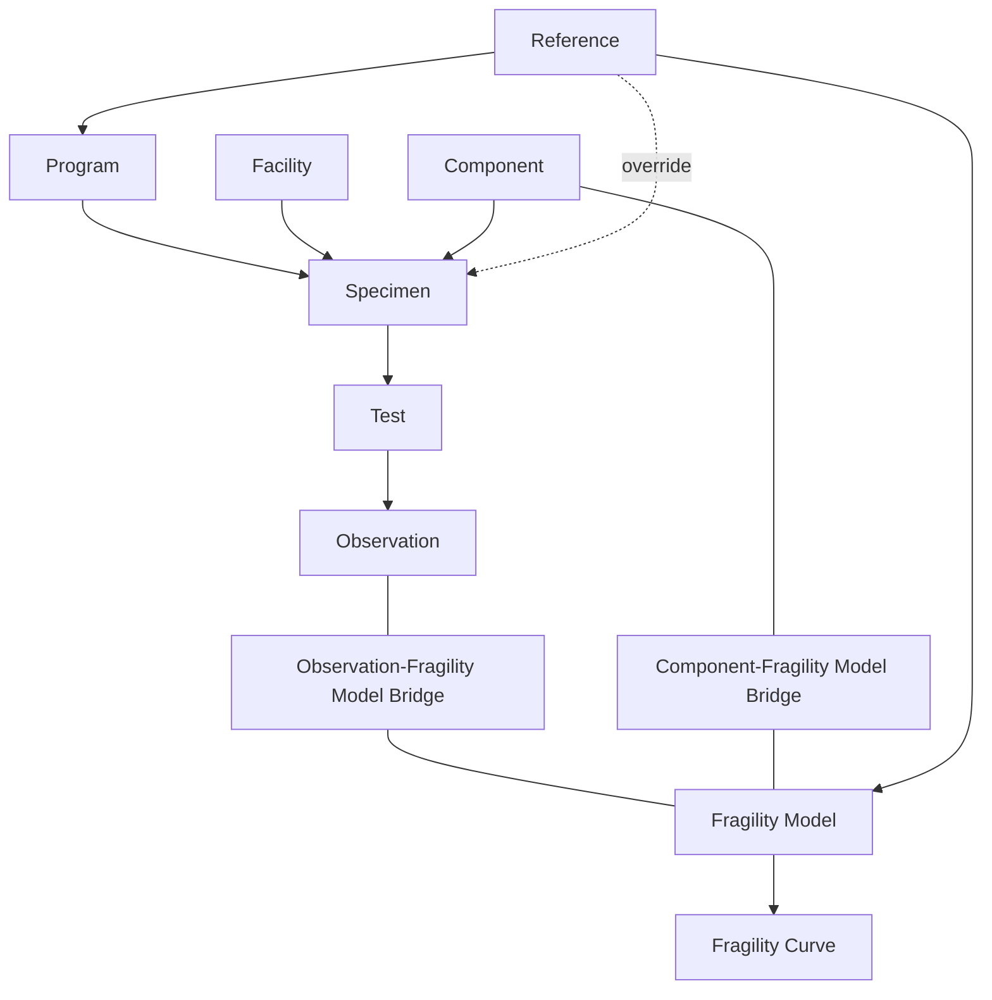

# NED Data Dictionary

This document describes the attributes of the main tables in the NED database. This is
a reference document; the authoritative definition of the schema is
[`ned_app/models.py`](https://github.com/usnistgov/NED/blob/main/ned_app/models.py)
and this document is updated occasionally and may lag behind small schema changes.

**Conventions used below:**

- **Required** means the field must be given a non-empty value when adding a record.
  **Optional** means it may be left blank/empty.
- **Auto** means the field is generated by the ingest pipeline — do **not** fill it in
  yourself; any value you supply is ignored or overwritten.
- **Not stored** means the value is computed from other records whenever it is read;
  it is neither in the JSON nor a database column.
- **Deprecated** fields keep data from before the hierarchy was introduced. New records
  leave them blank, and they will be removed in a future update.
- *String (max N)* is free text up to N characters. *Text* is free text with no length
  limit. *Choice* fields must exactly match one of the listed values (case-sensitive).
- *Label (max 100)* is a short identifier chosen by the contributor, from which NED
  derives the record's id (see **Identifiers** under [Hierarchy](#hierarchy)). The
  rules for writing one are in
  *[Label rules](https://github.com/usnistgov/NED#label-rules)* in the NED README.
- Shared choice lists (used by more than one table) are defined once in
  [Shared choice vocabularies](#shared-choice-vocabularies) at the end.

---

## Hierarchy

Experimental data is stored as a hierarchy. A **program** is the body of tests
documented by one reference. Each **specimen** in a program is one type of
**component**, tested at one **facility**. A specimen can be tested more than once,
and each **test** records one or more **observations** of damage. Fragility models are
linked to the observations and components they are based on through two bridge tables.

Each arrow points from a record to the records that refer to it by id. The dotted arrow
is a specimen's optional reference override (see `Specimen.reference`), and the plain
lines are the bridges' many-to-many links.

**Identifiers.** Each record in the hierarchy has a contributor-chosen `label`, and NED
derives its id by joining its parent's id and its label with `|`. For example,
`Smith-2020|W1|1|obs01` is observation `obs01` of test `1` of specimen `W1`, in the
program of reference `Smith-2020`. A record's JSON stores its own `label` and its
parent's id, never its own derived id. Two ids are not joined: the facility has no
parent, so its label is its id. The program's id is its label, or its reference's
`reference_id` when the label is blank (see `Program.program_id`). To change a label
or a citation once records depend on it, use `rename_identity`; see
*[Changing an identifier](https://github.com/usnistgov/NED#changing-an-identifier)* in
the NED README.

## Reference

Bibliographic records of the published studies and documents from which all data in
the database is drawn. One row per published source (journal paper, report, guideline document). Every
program and fragility model must point at a reference.

| Field | Type | Required | Description |
|---|---|---|---|
| `reference_id` | String (max 255), unique | Auto | Unique identifier, derived at ingest as `<token>-<year>` where the token is the `reference_label` if set, otherwise the first author's surname stripped to letters/digits (e.g. `Smith-2020`, `FEMA_P58-2018`, `ArayaLetelier-2019`). Never assign this manually — any supplied value is stripped and re-derived. |
| `reference_label` | String (max 100) | Optional | Overrides the first-author surname as the id token. Use it for institutional authors (e.g. `FEMA_P58`) or to distinguish two references that would otherwise derive the same id (same surname and year) — in the collision case a label is **required**. See the `reference_label` rule in *[Label rules](https://github.com/usnistgov/NED#label-rules)* for the characters allowed. |
| `title` | String (max 255) | Auto | Title of the paper or manuscript. Populated from `csl_data['title']`; not editable. |
| `author` | String (max 255) | Auto | Author display string built from `csl_data['author']` family names: one author → `Smith`; two → `Smith and Jones`; three or more → `Smith et al.`. Not editable. |
| `year` | Integer | Auto | Publication year, taken from `csl_data['issued']['date-parts']`. Not editable. |
| `study_type` | Choice | Required (defaults to `Other`) | Classification of the type of study conducted. One of the [Study type](#study-type) values. |
| `comp_type` | String (max 255) | Optional | The type of component(s) investigated in the study (e.g. "suspended ceilings"). |
| `csl_data` | JSON object (CSL-JSON) | Required | Full bibliographic record in [CSL-JSON](https://citeproc-js.readthedocs.io/en/latest/csl-json/markup.html) format. Must contain a non-empty `title`, a non-empty `author` list, and an `issued` field with `date-parts` containing at least a valid positive-integer year. Do **not** include an `id` key — it is stripped at ingest. **Year policy:** when the online-first year and the print-volume year differ, `issued` holds the online-first (first-available) year. |

## Component

The catalog of nonstructural building component types, classified using the
UNIFORMAT II / NISTIR 6389 hierarchy, optionally extended with suffix levels for
finer component types. One row per type of building component. See
*[Component Subcategorization Hierarchy](https://github.com/usnistgov/NED#component-subcategorization-hierarchy)*
in the NED README for guidance on categorizing components.

| Field | Type | Required | Description |
|---|---|---|---|
| `id` | String (max 10), primary key | Auto | Compact form of `component_id` with the four UNIFORMAT II / NISTIR levels concatenated (e.g. `B.20.1.1.A` → `B2011.A`). Generated on save; scheduled to be replaced by an integer key in a future update. |
| `component_id` | String (max 20), unique | Required | Dotted UNIFORMAT II / NISTIR component ID, e.g. `A.10.1.1` or `B.20.1.1.A`. Must have at least four levels, and the first four levels must exist in the UNIFORMAT II / NISTIR taxonomy (`ned_app/schemas/nistir_labels.json`). Additional dotted suffix levels may be appended to distinguish component types within a UNIFORMAT II / NISTIR subelement. This is the value that `Specimen.component` and the component–fragility bridge point at. |
| `name` | String (max 255) | Required | Name of the individual type of building component (e.g. "Suspended ceiling, perimeter-fixed"). |
| `major_group` | String (max 255) | Auto | UNIFORMAT II / NISTIR level-1 ID and description (e.g. `A - Substructure`). Populated from the taxonomy; not editable. |
| `group` | String (max 255) | Auto | UNIFORMAT II / NISTIR level-2 ID and description. Not editable. |
| `element` | String (max 255) | Auto | UNIFORMAT II / NISTIR level-3 ID and description. Not editable. |
| `subelement` | String (max 255) | Auto | UNIFORMAT II / NISTIR level-4 ID and description. Not editable. |

## Facility

The laboratories and test facilities where specimens were tested. One row per facility.

| Field | Type | Required | Description |
|---|---|---|---|
| `label` | Label (max 100), unique | Required | The facility's identity: a short-hand name such as `UCSD_LHPOST`, unique across the database regardless of case. A facility has no parent, so its label is its id, and `Specimen.facility` points at it. Migrated facilities are labelled from their old location text (`UCSD, California` → `UCSD_California`), or `unknown_<reference_id>` when the location was not recorded, until they are curated. |
| `name` | String (max 255) | Optional | The facility's full official title (e.g. "Englekirk High Performance Large Outdoor Shake Table"). Display only; blank on migrated facilities until they are curated. |
| `location` | String (max 255) | Optional | Where the facility is (e.g. lab, institution, and/or country). Migrated facilities keep the old free-text location verbatim. Shown in the browser UI's Location column. |
| `notes` | Text | Optional | Free-text notes about the facility. |

## Program

A body of tests documented by one reference. One row per program. Most references
document a single program, which has a blank `label`.

| Field | Type | Required | Description |
|---|---|---|---|
| `program_id` | String (max 255), unique | Auto | The program's identity: its `label` if set, otherwise its reference's `reference_id` (e.g. `Smith-2020`). Derived at ingest and not stored in the JSON; unique regardless of case. This is the value `Specimen.program` points at. |
| `label` | Label (max 100) | Optional | Replaces the reference id as the program's id. Leave it blank for a reference's only program; set it only when one reference documents more than one program. Because it replaces the reference id outright, it must be unique across the database, not just within its reference. |
| `reference` | Foreign key → `Reference.reference_id` | Required | Derived id of the reference that documents the program (e.g. `Smith-2020`). The reference must already exist. |
| `name` | String (max 255) | Optional | The program's full descriptive title. Display only; nothing derives from it. Blank on migrated programs until they are curated. |
| `notes` | Text | Optional | Free-text notes about the program. |

## Specimen

The physical specimens tested in a program. One row per specimen: one physical
specimen of one component type, tested at one facility. The specimen is the unit of
contribution, so the component description and attribution live here. Values already
used for `comp_detail`, `material`, `size_class`, `design_objective` and
`governing_design_standard` are listed per component in
[resources/import_templates/README.md](https://github.com/usnistgov/NED/blob/main/resources/import_templates/README.md),
a snapshot generated by `scripts/list_field_values.py`.

| Field | Type | Required | Description |
|---|---|---|---|
| `specimen_id` | String (max 255), unique | Auto | The specimen's identity, `{program}\|{label}` (e.g. `Smith-2020\|W1`). Derived at ingest and not stored in the JSON. This is the value `Test.specimen` points at. |
| `program` | Foreign key → `Program.program_id` | Required | The `program_id` of the program the specimen belongs to (e.g. `Smith-2020`). |
| `label` | Label (max 100) | Required | Short identifier for the specimen, unique within its program regardless of case (e.g. `W1`, `Config8._Specimen_20`). |
| `name` | String (max 255) | Optional | The specimen's ID or name as the reference writes it, verbatim (e.g. "Config8. Specimen 20"). Display only: the browser UI shows it in the Specimen column, or the `label` when it is blank. |
| `facility` | Foreign key → `Facility.label` | Required | Label of the facility where the specimen was tested. |
| `reference` | Foreign key → `Reference.reference_id`, nullable | Optional | Override, for a specimen documented by a different reference than its program's; null otherwise, as on every migrated specimen. **Effective reference** = this reference if set, otherwise the program's reference. The browser UI applies this rule. |
| `contributor` | String (max 50) | Optional | Individual or institution responsible for entering this specimen into the database. |
| `component` | Foreign key → `Component.component_id` | Required | Dotted component ID identifying the component type (e.g. `D.50.2.1.A`). The component must already exist. |
| `comp_detail` | String (max 100) | Optional | Subcategorization tag: classification or short description of the component attachment/connection detailing (e.g. `perimeter-fixed` vs `back-braced`). Use consistent naming, case, and spelling across records. |
| `material` | String (max 100) | Optional | Subcategorization tag: general material grouping of the component, if applicable (e.g. `CPVC` vs `iron` sprinkler pipes). |
| `size_class` | String (max 100) | Optional | Subcategorization tag: general size grouping of this component relative to others of the same type, if applicable. |
| `design_objective` | Text | Optional | Performance level to which the specimen was designed, e.g. code compliant, common construction practice, low-damage design, or meeting a certain damage objective under a specific loading condition. |
| `governing_design_standard` | String (max 255) | Optional | Name of the standard governing the design of the specimen, if applicable. |
| `comp_description` | Text | Required | General description of the type of component tested. |
| `notes` | Text | Optional | Free-text notes about the specimen. |
| `number_of_tests` | Integer | Not stored | The number of tests NED holds for this specimen. This is not always the number of tests the reference reports. |

## Test

The tests run on each specimen. One row per test: one loading run of one specimen,
whose damage is recorded as one or more observations.

| Field | Type | Required | Description |
|---|---|---|---|
| `test_id` | String (max 255), unique | Auto | The test's identity, `{specimen}\|{label}` (e.g. `Smith-2020\|W1\|1`). Derived at ingest and not stored in the JSON. This is the value `Observation.test` points at. |
| `specimen` | Foreign key → `Specimen.specimen_id` | Required | The `specimen_id` of the specimen tested (e.g. `Smith-2020\|W1`). |
| `label` | Label (max 100) | Required | Short identifier for the test, unique within its specimen regardless of case (e.g. `Test_14`, `B-1`). Labels carry no order: the order is `test_order`. See *[Label rules](https://github.com/usnistgov/NED#label-rules)* for how to name a test. |
| `test_order` | Positive integer | Optional | The test's place in the specimen's test order, taken from the reference's test numbers. Unique within the specimen when set. See the `test_order` rule in *[Label rules](https://github.com/usnistgov/NED#label-rules)* for how to fill it in. Shown in the browser UI as the Inspection Sequence. |
| `test_type` | Choice | Required | The loading condition of the test. One of the [Test type](#test-type) values. |
| `loading_protocol` | Text | Optional | Name, ID, or general description of the ground motion or loading protocol used in the test. |
| `peak_test_amplitude` | String (max 255) | Optional | The maximum amplitude to which this test was performed (recorded as text, so units/qualifiers can be included). |
| `prior_damage` | Text | Optional | The condition the specimen was in entering this test, including damage from outside NED's records. It describes the test, not the previous observation. Blank on every migrated test; the old per-observation values are kept in `Observation.legacy_prior_damage`, which is what the browser UI still shows. |
| `prior_damage_repaired` | Text | Optional | Whether the prior damage entering this test was repaired before it. Blank on every migrated test; the old values are kept in `Observation.legacy_prior_damage_repaired`. |
| `notes` | Text | Optional | Free-text notes about the test, e.g. that its `test_order` was assigned rather than taken from the reference. |
| `damaged_by_earlier_test` | Boolean or empty | Not stored | Whether an earlier test of the same specimen holds observations. True when the test has a `test_order` and a test with a lower `test_order` holds observations; false when the test is the specimen's only test, or when every test has a `test_order` and no lower-ordered test holds observations; otherwise empty (the specimen has several tests and the order needed to tell is not recorded). |

## Observation

Records of observations of performance and damage from experimental testing programs
of nonstructural components. One row per **observation of component damage** (or
explicit non-damage) in a single test of a single specimen. A test that produced
several damage states, or damage at several places on the specimen, has several
observations.

| Field | Type | Required | Description |
|---|---|---|---|
| `observation_id` | String (max 255), unique | Auto | The observation's identity, `{test}\|{label}` (e.g. `Smith-2020\|W1\|1\|obs01`). Derived at ingest and not stored in the JSON. This is the value the observation–fragility bridge points at. Ids from before the hierarchy (`exp…`) are mapped to their observations in `resources/archive/observation_id_map.json`. |
| `test` | Foreign key → `Test.test_id` | Required | The `test_id` of the test this observation belongs to (e.g. `Smith-2020\|W1\|1`). |
| `label` | Label (max 100) | Required | Short identifier for the observation, unique within its test regardless of case. It is also the sort key: the observations of a test are shown in label order, compared as text. See *[Label rules](https://github.com/usnistgov/NED#label-rules)* for how to number them. |
| `damage_location` | String (max 255) | Optional | Where on the specimen the damage was observed. |
| `ds_description` | Text | Required | Description of the damage being observed (or observation of no damage). |
| `ds_class` | Choice | Required | First-pass classification of whether the damage is consequential, assigned by the individual or institution entering this record into the database. One of the [Damage state class](#damage-state-class) values. When in doubt, err toward `Consequential`; use `Unknown` only when a class cannot be identified. See *[DS Class](https://github.com/usnistgov/NED#ds-class)* in the NED README for additional information. |
| `edp_metric` | Choice | Required | The engineering demand parameter (EDP) measured at this observation. One of the [EDP metric](#edp-metric) values. |
| `edp_unit` | Choice | Required | Unit of the EDP. One of the [EDP unit](#edp-unit) values; must be consistent with `edp_metric`. |
| `edp_value` | Decimal (up to 12 digits, 6 decimal places) | Required (blank only when genuinely unavailable) | Value of the EDP recorded for this observation, in `edp_unit`. |
| `alt_edp_metric` | Choice | Optional | Secondary EDP metric, when the reference reports the demand a second way. Same choice list as `edp_metric`. |
| `alt_edp_unit` | Choice | Optional | Unit of the secondary EDP. Same choice list as `edp_unit`. |
| `alt_edp_value` | Decimal (up to 12 digits, 6 decimal places) | Optional | Value of the secondary EDP; stored as null when blank. |
| `notes` | Text | Optional | Additional notes providing context for the damage observation. |
| `legacy_prior_damage` | Text | Deprecated | The old per-observation prior damage, copied verbatim, which the browser UI still shows as Prior Damage: a description of any damage noted during a previous test of this specimen, including if and how the specimen was repaired before this test; empty if no prior damage was noted. Superseded by `Test.prior_damage`. |
| `legacy_prior_damage_repaired` | Text | Deprecated | The old per-observation repaired flag, copied verbatim, which the browser UI still shows as Prior Damage Repaired: `TRUE` if prior damage was noted and repaired before this test; `FALSE` if noted and not repaired; or a general description of the previous damage that was repaired. Superseded by `Test.prior_damage_repaired`. |
| `legacy_ds_rank` | Integer | Deprecated | The old damage-state rank, copied verbatim, which the browser UI still shows as DS Rank: an integer rank ordering this observed damage relative to other damage observed in the same specimen (1 = first/least severe), as recorded by the original author in the reference. Superseded by the observation `label`, which sets the order. |

## Fragility Model

Seismic fragility models describing the sequence of damage of a particular nonstructural component configuration as a function of demand. One row per unique fragility model. The damage states of a given fragility model are defined in the Fragility Curve table.

| Field | Type | Required | Description |
|---|---|---|---|
| `fragility_model_id` | String (max 255), unique | Auto | Generated on save as `<reference_id>\|<model_id>` (e.g. `Smith-2020\|fra001`). This is the value the curve table and bridge tables point at. |
| `reference` | Foreign key → `Reference.reference_id` | Required | Derived id of the reference documenting this fragility model. |
| `model_id` | String (max 255) | Required | Model identifier chosen by the contributor; must be unique within the reference (the pair reference + model_id is enforced unique). Use an id provided by the original author if available in the reference. |
| `p58_fragility` | String (max 50) | Optional | FEMA P-58 fragility id associated with this model, if applicable (e.g. `C3032.001a`). |
| `comp_detail` | String (max 100) | Optional | Subcategorization tag: classification or short description of the component attachment/connection detailing (e.g. `perimeter-fixed` vs `back-braced`). Use consistent naming, case, and spelling across records. |
| `material` | String (max 100) | Optional | Subcategorization tag: general material grouping of the component, if applicable (e.g. `CPVC` vs `iron` sprinkler pipes). |
| `size_class` | String (max 100) | Optional | Subcategorization tag: general size grouping of this component relative to others of the same type, if applicable. |
| `comp_description` | Text | Required | General description of the type of component the model applies to. |
| `contributor` | String (max 255) | Optional | Person or party responsible for uploading this fragility model to the database. |
| `source` | String (max 255) | Optional | Source of the fragility data. |
| `edp_metric` | Choice | Required (database-enforced non-empty) | The EDP the fragility curves are defined against. One of the [EDP metric](#edp-metric) values. |
| `edp_unit` | Choice | Required (database-enforced non-empty) | Unit of the EDP. One of the [EDP unit](#edp-unit) values. |

## Fragility Curve

The individual lognormal damage-state curves that make up each fragility model. One row per individual fragility curve — a lognormal distribution for one damage state within a fragility model.

| Field | Type | Required | Description |
|---|---|---|---|
| `fragility_model` | Foreign key → `FragilityModel.fragility_model_id` | Required | Id of the fragility model this curve belongs to (e.g. `Smith-2020\|fra001`). |
| `basis` | Choice | Optional | Observational basis of the underlying data comprising the curve. One of the [Study type](#study-type) values. |
| `num_observations` | Integer | Optional | Number of observations that form the basis of the curve. |
| `ds_rank` | Integer | Optional | Rank ordering this curve relative to the other curves in the same fragility model (1 = first/least severe damage state). |
| `ds_description` | Text | Required | Description of the damage being modeled by this curve. |
| `median` | Decimal (up to 9 digits, 4 decimal places) | Required | Median of the lognormal fragility curve, in the model's `edp_unit`. Must be strictly greater than 0. |
| `beta` | Decimal (up to 4 digits, 3 decimal places) | Required | Lognormal dispersion (standard deviation of the log of the demand). Must be strictly greater than 0. |
| `probability` | Decimal (up to 3 digits, 2 decimal places) | Required | Mutually exclusive probability of this damage state, for models with mutually exclusive damage states. Must be between 0 and 1 inclusive. Use a probability of 1 for purely sequential damage states. |

## Observation–Fragility Model Bridge

Links observations to the fragility models derived from them, many-to-many. One row
per observation–model pair. Add links with `import_model --model
ObservationFragilityModelBridge` once both records exist.

| Field | Type | Required | Description |
|---|---|---|---|
| `observation` | Foreign key → `Observation.observation_id` | Required | The full `observation_id` of the linked observation (e.g. `Smith-2020\|W1\|1\|obs01`). |
| `fragility_model` | Foreign key → `FragilityModel.fragility_model_id` | Required | The full `fragility_model_id` of the linked fragility model (e.g. `Smith-2020\|fra001`). |

## Component–Fragility Model Bridge

Links fragility models to the component types they apply to, many-to-many. One row per
component–model pair. `import_fragility` writes these from its `component_ids` column.

| Field | Type | Required | Description |
|---|---|---|---|
| `component` | Foreign key → `Component.component_id` | Required | Dotted component ID of the linked component type (e.g. `D.50.2.1.A`). |
| `fragility_model` | Foreign key → `FragilityModel.fragility_model_id` | Required | The full `fragility_model_id` of the linked fragility model (e.g. `Smith-2020\|fra001`). |

---

## Shared choice vocabularies

Choice fields must match one of these values **exactly** (including case and
punctuation).

### Study type

Used by `Reference.study_type` and `FragilityCurve.basis`.

| Value | Meaning |
|---|---|
| `Experiment` | Laboratory experimental testing. |
| `Historical Event` | Reconnaissance observations from a real (historical) event. |
| `Analytical Study` | Analytical/numerical study. |
| `Lit Review` | Literature review / compilation of prior studies. |
| `Judgment` | Expert judgment. |
| `Other` | Anything not covered above. |

### Test type

Used by `Test.test_type`.

| Value |
|---|
| `Dynamic, uniaxial` |
| `Dynamic, bi-directional` |
| `Dynamic, horizontal and vertical` |
| `Dynamic, 3D` |
| `Monotonic, compression` |
| `Monotonic, tension` |
| `Monotonic, bending` |
| `Monotonic, lateral` |
| `Quasi-static Cyclic, uniaxial` |
| `Quasi-static Cyclic, bi-directional` |

### EDP metric

Used by `Observation.edp_metric`, `Observation.alt_edp_metric`,
and `FragilityModel.edp_metric`.

| Value |
|---|
| `Story Drift Ratio` |
| `Story Drift Ratio, bi-directional` |
| `Residual Story Drift Ratio` |
| `Peak Floor Acceleration, horizontal` |
| `Peak Table Acceleration, horizontal` |
| `Peak Floor Acceleration, vertical` |
| `Peak Floor Velocity` |
| `Joint Rotation` |
| `Force, tension` |
| `Force, compression` |
| `Force, bending` |
| `Force, lateral` |
| `Custom` |

### EDP unit

Used by `Observation.edp_unit`, `Observation.alt_edp_unit`,
and `FragilityModel.edp_unit`.

| Value |
|---|
| `g` |
| `Ratio` |
| `Radians` |
| `Kips` |
| `k-in` |
| `Meters Per Second` |
| `Custom` |

### Damage state class

Used by `Observation.ds_class`. See *[DS Class](https://github.com/usnistgov/NED#ds-class)*
in the NED README for the full discussion of intent and edge cases.

| Value | Meaning |
|---|---|
| `No damage` | No change in state was observed from the test. |
| `Inconsequential` | (Aesthetic) damage was observed but is unlikely to require repair or impact system operation — no action required. |
| `Consequential` | Damage that may require repair or impact system operation — observable and requires action. |
| `Unknown` | A damage state class could not be identified by the contributor. |
